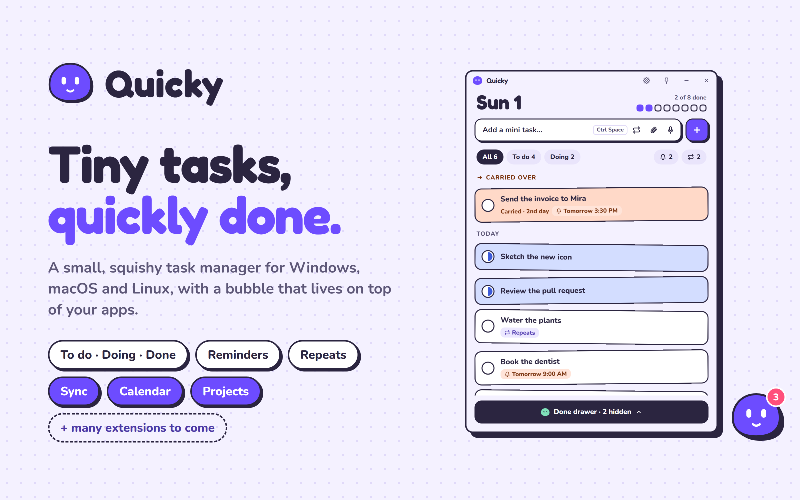

# Quicky

**[quicky.pistasspot.com](https://quicky.pistasspot.com)**

A tiny, cute task manager for Windows, macOS and Linux. Add mini tasks fast, mark them **To do → Doing → Done**, and let unfinished ones roll over to the next day on their own. A little bubble waits on screen, and any app can get its own mini Quicky with a list of its own. Sign in to keep your tasks the same on every PC, and add extensions for shared calendars and whiteboards.



## Install

Get it from **[quicky.pistasspot.com](https://quicky.pistasspot.com)**, or open the [latest release](../../releases/latest) and download the file for your system.

- **Windows:** **`Quicky_x.y.z_x64-setup.exe`**. Run it: it installs for your user only, no admin needed, and adds Quicky to the Start menu (and a desktop shortcut). If Windows shows *"Windows protected your PC"*, click **More info**, then **Run anyway**: the installer isn't code-signed yet.
- **macOS** (11 or newer, Apple silicon and Intel): **`Quicky_x.y.z_universal.dmg`**. Open it and drag Quicky into Applications. Quicky isn't notarized by Apple yet, so the first time you open it macOS says it can't check it for malware: open **System Settings**, **Privacy & Security**, and click **Open Anyway** next to Quicky.
- **Linux** (x86-64): the **`.AppImage`** (make it executable and run it) or the **`.deb`**.
- **Android** (7 or newer): **`Quicky_x.y.z_android.apk`**. Open it on the phone and allow installing from your browser or files app when Android asks. Later versions install over it, keeping your tasks.

Or on Windows, from a terminal, with the [GitHub CLI](https://cli.github.com):

```bash
gh release download --repo PISTAfff/quicky --pattern "*-setup.exe" --dir . && ./Quicky_*_x64-setup.exe
```

On first launch Quicky asks where to keep your data and creates a `Quicky` folder there (picking a folder that's already called `Quicky`, or one that already holds `quicky.json`, uses it as is). Quicky works offline from that folder; signing in (Settings → Online) also syncs it to your account.

## Using it

| | |
|---|---|
| **Ctrl+Space** (also **⌥ Space** on macOS) | Open Quicky from anywhere and jump to the add box (in an app with a mini, that app's list); press it again to close Quicky |
| **Ctrl+Shift+Space** (also **⌥⇧ Space** on macOS) | Show or hide the bubble |
| **Ctrl+Shift+D** (**⌥⇧ D** on macOS) | Draw on screen, once the Draw on screen extension is installed (also from the bubble's right-click menu); **Esc** leaves |
| **Enter** | Add the task |
| **Click the circle** | To do → Doing → Done |
| **Right-click the circle** | Step back |
| **Right-click a task** | Edit, start, finish, pin to the bubble, put off until tomorrow, or delete it |
| **Ctrl+F** (**⌘F**) | Search every list |
| **Ctrl+N** (**⌘N**) | Focus the add box |
| **Esc** | Close a panel |

Every shortcut above with Ctrl (or ⌘ / ⌥) can be changed in **Settings → Shortcuts**: choose *Change* and press the new keys, *Reset* puts one back. They're kept per PC, and Quicky says so when another app already has the keys you picked.

- **Draw on screen** (an extension: Settings → Extensions): pen, highlighter and eraser in a few colours (Quicky's first) and sizes, rectangles, ellipses, lines, arrows and text, a spotlight and a laser pointer for presenting, undo, redo and clear, all from a toolbar you can drag anywhere. *Click-through* keeps the drawing up while you use the apps underneath; the camera button copies a screenshot of the screen with your drawing and saves it to Pictures › Quicky (Windows and Linux). Leaving clears the drawing.

- **Carry-over:** anything not done moves to today, tinted peach with a "Carried · 2nd day" label.
- **Repeats:** the repeat button in the add box opens a day picker: choose exactly which days (S M T W T F S) or Every day. Pick exact weekdays, pause, or stop a repeat from the task or the Repeats list. Each repeat appears once per matching day and never duplicates.
- **Done drawer:** finished tasks hide in the drawer, grouped by day. Restore any of them to today. Ticking a task off shows a quick Undo.
- **Media:** attach files with the paperclip, record a voice note with the mic (a live wave shows your voice while it records; ✕ discards, ■ saves), paste images into the add box, or drop files anywhere on the window. If a task is open, dropped files attach to it.
- **Any size:** drag the window to any shape, or maximize it with the square in the title bar. It becomes a mini "next up" panel when small, a list by default, and a board with To do / Doing / Done columns when wide (drag cards between columns). The pin button keeps it on top.
- **Bubble:** while the app is closed, a little Quicky waits on screen (bottom-left at first), always on top, even over the taskbar, with a badge showing how many tasks are left. Click it to open the app right next to it. Drag it anywhere, on any screen, even over an app (to give an app a mini, drag the bubble onto it with the right mouse button instead); right-click to lock it in place, send it back to the corner, or hide it. Locked, it won't move: tug it and it behaves like jelly: the side you pull stretches after your pointer, it gets angrier the harder you pull, and it snaps back and wobbles to a stop when you let go. Bring a hidden bubble back from Settings or the tray menu.
- **Starts at sign-in:** on by default. Quicky starts quietly at sign-in (tray icon and bubble only). Turn it off, or hide the bubble, in Settings (the gear in the title bar).
- **Reminders:** in a task, *Remind me* has a switch and four ways to schedule: **Once** (a date and time, or quick picks like "In 30 min" / "Tomorrow 9 AM"), **Daily** (any number of editable times, with Morning/Noon/Afternoon/Evening presets), **Some days** (pick the weekdays), and **Repeat** (every 15 min to 3 hours between two times). It shows a plain summary and the next few times; *Not today* skips today, *Stop reminders* clears it, and "Nudge me once in 15m/30m/1h/2h" adds a one-off. The bell pill (or Settings → Reminders → *See all*) lists every reminder across all lists to pause, resume or stop. Times show as AM/PM. Only tasks still to do remind you. When it's time, Quicky pours out of the bubble and fills every screen (the task shows on the bubble's screen) until you answer: **D** I'm on it, **Enter** Done, **O** open the task, **S**/**Esc** snooze 10 min, **1/3/4** snooze 5/30/60 min.
- **Search:** the magnifier in the title bar (or Ctrl+F) searches every list at once, done tasks too: titles, notes, steps and file names, ignoring case and accents.
- **Due dates:** give a task a day it's due (Today, Tomorrow or any date). Cards show "Due Fri", "Due today" or "Overdue · Mon 3" (with a red edge on the card), and lists put Doing first, then whatever is due soonest.
- **Not today:** put a task off until tomorrow or a day you pick. It hides (its reminders wait too) in the *Later* list next to the Done drawer, and comes back on its day as a fresh task. *Back to today* brings it back early.
- **Steps:** break a task into a small checklist. Cards show "2/3"; ticking the last step offers to finish the task. A repeating task gives each new copy the same steps, unticked.
- **Pin to the bubble:** pin the task you're working on (in the task, *Pin to the bubble*). A speech balloon over the bubble shows it with how long you've been at it, and when you finish it the bubble hops and cheers.
- **Peek:** rest the pointer on the bubble or a mini for a moment: the balloon shows the top three tasks of its list.
- **Drop on the bubble:** drag text, a link or files onto the bubble (or a mini) and it gulps them into a new task in its list: the first line becomes the title, links keep their address in the note, and files are attached.
- **Quiet hours:** Settings, Reminders: reminders wait during the hours you pick, and (on by default) while a full-screen app, game, video or presentation is in front. When it's over, the ones that waited show together on one screen.
- **Tour:** three quick tips on first run; Settings, Tips shows them again.
- **Quick status:** hover a card (always shown in small windows) for one-tap **▶ Doing** / **✓ Done** (or **↺** back to To do) without opening the task.
- **Sounds:** little synthesized sound effects for adding, finishing, deleting, panels, voice notes, the bubble (tap, squash, boing, pop, divide) and reminders. Turn them off or change the volume in Settings.
- **Mini Quicky in your apps:** drag the bubble onto any app's window with the right mouse button and Quicky *divides*: one half stays as that app's own mini Quicky right there, the other hops home and stays there as the bubble. Whenever that app is focused (and Quicky is closed) its mini pops up at its spot, gliding along with the window, while the bubble keeps its own spot with the general list. A mini lives inside its app: drag it around (with either button) and the window edges are walls. Push it against a wall and hold: it squashes flatter, gets angrier and squeaks higher until it pops out, and that app's mini is gone. Each mini has its own *Lock this mini in place* in its right-click menu, separate from the normal bubble's lock. You can also right-click a mini → *Hide this mini Quicky*: it puffs into droplets that fly home into the bubble. Either way, right-drag Quicky onto the app again to bring it back. (Store apps all share one host process, so they share one mini.)
- **Each app has its own tasks:** clicking an app's mini (or pressing Ctrl+Space in that app) opens that app's own list, inside the app: it covers the app with a small margin, and if you resize or move it, that's remembered for that app. It can't be dragged, resized or snapped past the app's edges (maximizing fills just the app). The title-bar pill (with the app's icon) switches between General and your apps' lists, with a count of open tasks for each.
- **Popover, not a background window:** Quicky tucks itself away as soon as you click into another app, and the bubble (and that app's mini) come back. Pin it (📌) to keep it open and on top.
- **Colours:** Settings (gear in the title bar) has five accents (Grape, Bubblegum, Mint, Tangerine, Ocean) plus a rainbow swatch to pick any colour you like, and Light / Dark / Match the system. The bubble and the taskbar (Dock on macOS) and tray icons follow along.
- **Tray icon:** left-click opens or hides Quicky, right above the tray. Right-click for *Show* and *Quit*. **Close** only hides Quicky, so Ctrl+Space and the bubble keep working.
- **Sync:** sign in from Settings → Online and your tasks, repeats, steps, each app's list, attachments (pictures are shrunk before upload; up to 25 MB a file, 500 MB in all) and your colours, sounds and quiet hours stay the same on every PC signed in to the account, live. Changes made on two PCs at once are merged, never lost. *Sync my tasks and settings* turns it off.
- **Extensions:** Settings → Online → Extensions adds them; open one from there or by right-clicking the bubble → *Extensions*.
  - **Projects:** a shared whiteboard with task cards, sticky notes, text, shapes and containers, arrows that route themselves around cards (and hop over each other), images and voice notes, with everyone's changes live.
  - **Calendar:** shared calendars with month and week views, all-day, timed and multi-day events, repeats, colours and notes. Event reminders show on Quicky's own reminder screen. Your tasks with due dates show on it and can be edited there, and any event can become a Quicky task or a card on a board.
  - Share a board or calendar with its join code; changing the code locks everyone else out again.
- **Updates:** Quicky checks GitHub for a new version a little after it starts and twice a day, and shows a banner when one is ready. *Update and restart* installs it. Check by hand, or turn the automatic check off, in Settings → Updates.

## On macOS and Linux

Everything works the same, with a few differences:

- **macOS:** the quick-add shortcut is **⌥ Space**, and **Ctrl+Space** too unless macOS uses it to switch keyboard input sources (then macOS keeps it). The first voice note asks for the microphone. Quicky lives in the menu bar and the Dock; clicking the Dock icon opens it. Minis work with any app.
- **Linux:** Quicky runs on X11 (through XWayland in a Wayland session), because Wayland doesn't let an app place its own windows. Minis work with apps that run on X11 too; apps running natively on Wayland get the normal bubble. The tray icon opens a menu (*Show Quicky*, *Show bubble*, *Quit*) rather than toggling Quicky with a click.

## On Android

Quicky for Android has the same task list (To do / Doing / Done, due dates, steps, repeats, reminders, attachments and voice notes) and the same look. Sign in with the same account and sync keeps the phone and every PC the same; the phone keeps its own copy too, so it works offline.

- **Reminders** are notifications, even with Quicky closed, with *Done* and *Snooze 10 min* buttons. Quiet hours hold them until they end. They are set up a week ahead each time Quicky opens. Android 13 and up asks once whether Quicky may notify; Settings → Reminders shows whether exact times are allowed and has a test.
- **Widgets** (long-press the home screen → Widgets → Quicky):
  - *Quicky tasks*: the open tasks; tap the ring to tick one off, the title to open it, + to add one.
  - *Quicky add*: one tap opens a small box to add a task.
  - *Quicky next up*: the pinned task (long-press a task → *Pin to next up*), or else the most urgent one, with a Done button.
  - *Quicky today*: today's calendar events and the tasks due today.
  - *Quicky this week*: the next 7 days' events and tasks due, under a heading per day.
  - *Quicky doing now*: the tasks in progress, each with a tick.
  - *Quicky*: the Quicky blob in your accent colour, with how many tasks are open; tap it to open the app. Resize it up to 2 × 2.

  Widgets show the tasks as the app last saw them. A tick or a task added from a widget shows on the widget at once and reaches your other devices the next time you open Quicky.
- **Extensions** open full screen. On the Projects board, one finger moves the board, two fingers pan and pinch to zoom.
- No bubble, minis, tray or quick-add shortcut on a phone; the widgets take their place. Long-press a task for its menu, and Android's back button closes panels.

## Your data

```
<your folder>/
├ quicky.json          tasks and repeats (plain JSON, saved atomically)
└ media/2026-11/…      copies of every attachment and voice note
```

Signed in with sync on, the same data also lives on Quicky's server, one copy per account. Without an account, put the folder in OneDrive or Dropbox to share it between PCs. Use the folder button in the title bar to open the folder or switch to another one. Switching doesn't move files.

## Develop

Needs Node 24+, pnpm and Rust (stable), plus the Visual Studio C++ Build Tools on Windows, Xcode's command line tools on macOS, or `libwebkit2gtk-4.1-dev libappindicator3-dev librsvg2-dev patchelf` on Linux (Debian and Ubuntu names).

```bash
pnpm install
```

```bash
pnpm tauri dev
```

```bash
pnpm test
```

```bash
pnpm tauri build
```

The installer lands in `src-tauri/target/release/bundle/` (`nsis/` on Windows, `dmg/` on macOS, `appimage/` and `deb/` on Linux). Builds also sign the update files, so set `TAURI_SIGNING_PRIVATE_KEY` to the private key (see Releasing) first. Every push to a branch builds all three on GitHub Actions (the *Build* workflow keeps the installers for a week).

**Android:** needs Android Studio's SDK (with an NDK) and its bundled JDK 21. Set `ANDROID_HOME` (e.g. `%LOCALAPPDATA%\Android\Sdk`), `NDK_HOME` (a folder in `$ANDROID_HOME/ndk`) and `JAVA_HOME` (Android Studio's `jbr`), then once:

```bash
rustup target add aarch64-linux-android x86_64-linux-android
```

A debug APK for an emulator (`x86_64`) or a phone (`aarch64`) lands in `src-tauri/gen/android/app/build/outputs/apk/`:

```bash
pnpm tauri android build --debug --apk --target x86_64
```

```bash
pnpm tauri android dev
```

The Android app is `mobile.html` (`src/mobile/`), set as its window in `src-tauri/tauri.android.conf.json`; notifications and widgets are Kotlin in `src-tauri/android-plugin/`. A tagged release also builds the signed APK (`Quicky_<version>_android.apk`, arm64, armv7 and x86_64 in one). The release key never goes in the repo: CI takes it from the repository secrets `ANDROID_KEYSTORE_BASE64`, `ANDROID_KEYSTORE_PASSWORD`, `ANDROID_KEY_ALIAS` and `ANDROID_KEY_PASSWORD`, and a local `pnpm tauri android build --apk` signs with `~/.quicky/android/keystore.properties` when it's there. Keep the keystore safe: every update has to be signed with the same key, or Android won't install it over the old app.

**Releasing:** bump the version in `package.json`, `src-tauri/tauri.conf.json` and `src-tauri/Cargo.toml`, then push a tag. GitHub Actions builds Windows, macOS and Linux into one release, signs the update files with the `TAURI_SIGNING_PRIVATE_KEY` repository secret (its password secret is empty), and publishes the release with `latest.json`, which installed copies read to update themselves. Keep the private key safe: without it, existing installs can't trust new versions.

```bash
git tag v0.1.40 && git push origin v0.1.35
```

Stack: [Tauri 2](https://tauri.app) (Rust + the system web view: WebView2, WebKit or WebKitGTK) and [SolidJS](https://www.solidjs.com).

## Code signing policy

Free code signing provided by [SignPath.io](https://about.signpath.io), certificate by [SignPath Foundation](https://signpath.org). This applies to the Windows installers from the first signed release on; until then they are unsigned.

- Committers and reviewers: [PISTAfff](https://github.com/PISTAfff) (the maintainer; every change is made or reviewed by them)
- Approvers: [PISTAfff](https://github.com/PISTAfff)
- Releases are built only by GitHub Actions from tagged commits of this repository ([release workflow](.github/workflows/release.yml)); nothing built anywhere else is signed.

Privacy: Quicky doesn't send anything to other networked systems unless you ask it to. Signing in (Settings, Online) syncs your tasks with Quicky's server and loads the extensions you add from it; the update check asks GitHub for new versions (turn it off in Settings, Updates). See the [privacy policy](https://quicky.pistasspot.com/privacy).

## License

[MIT](LICENSE): use it, change it and share it freely; keep the copyright notice.
